# StoreFront

A full-stack e-commerce: an **Angular 19** single-page app (with server-side rendering and four languages) talking to a small **Express** REST API that uses cookie-based **JWT** sessions


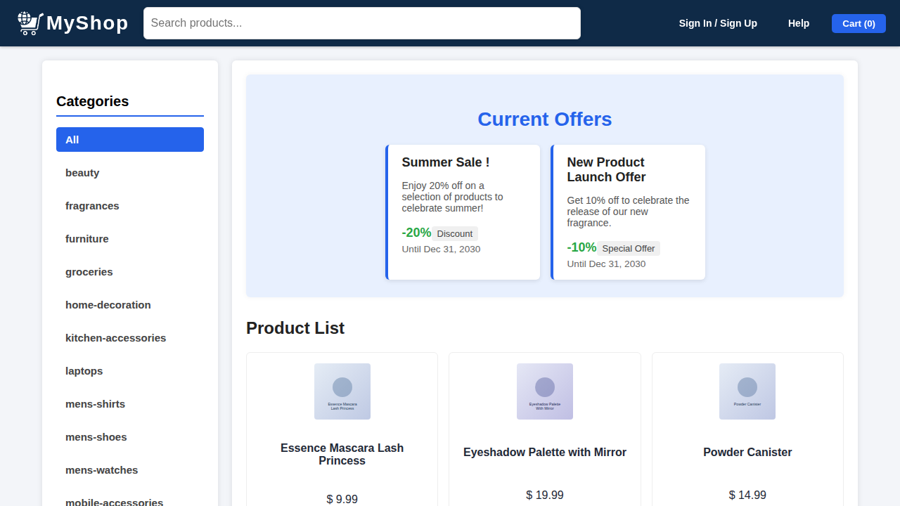

## Features

**Shoppers**

- Browse the catalog, filter by category and search by title
- Product detail pages with live stock badges (out of stock, low stock, recently restocked)
- Automatic discounts from active offers, shown next to the original price
- Shopping cart that survives page reloads (session storage)
- Checkout with a draggable delivery-location map (Leaflet / OpenStreetMap)
- Profile page with order history and order details
- Available in English, French, Spanish and Arabic (RTL)

**Administrators**

- Stock monitoring with restock / empty actions and low-stock alerts
- Offer management (create, edit, enable/disable, delete)
- User management (create, edit, delete)

## Tech stack

| Layer    | Technology |
| -------- | ---------- |
| Frontend | Angular 19 (standalone components, lazy routes, functional guards and interceptors), RxJS, Leaflet |
| Rendering | Angular SSR with hydration and event replay |
| i18n     | `@angular/localize`, XLIFF files for `fr`, `es`, `ar` |
| Backend  | Node.js, Express 4, `jsonwebtoken`, `cookie-parser`, `cors` |
| Security | `scrypt` password hashing, `httpOnly` + `SameSite=Strict` session cookie |
| Storage  | JSON files in `server/data` (swap for a database when needed) |

## Architecture

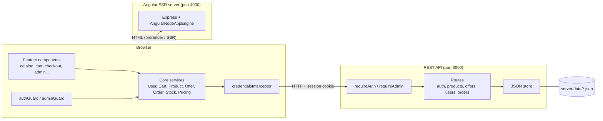

## Project structure

```text
.
├── src/
│   ├── app/
│   │   ├── core/                 # app-wide singletons
│   │   │   ├── config/           # API_URL injection token
│   │   │   ├── guards/           # authGuard, adminGuard
│   │   │   ├── interceptors/     # credentialsInterceptor
│   │   │   ├── models/           # Product, Offer, Order, User, cart types
│   │   │   └── services/         # data + state services
│   │   ├── features/             # one folder per page
│   │   │   ├── auth/             # signin, signup
│   │   │   ├── admin/            # stock-monitoring, offer-management, user-management
│   │   │   ├── cart/  catalog/  checkout/  map/
│   │   │   └── orders/  product-details/  profile/
│   │   ├── shared/               # alert, navbar, search-bar
│   │   ├── app.config.ts         # providers (router, http, hydration)
│   │   ├── app.routes.ts         # lazy routes + guards
│   │   └── app.routes.server.ts  # prerender / SSR mode per route
│   ├── locale/                   # messages.xlf + fr / es / ar translations
│   ├── main.ts  main.server.ts  server.ts
├── server/                       # REST API
│   ├── src/
│   │   ├── config.js  app.js  index.js
│   │   ├── lib/                  # JSON store, password hashing
│   │   ├── middleware/           # session + role checks
│   │   └── routes/               # auth, users, products, offers, orders
│   ├── data/                     # seed data (users, products, offers, orders)
│   └── scripts/                  # hash-password, import-products
├── docs/screenshots/
└── public/                       # static assets
```

## Getting started

### Prerequisites

- Node.js 18 or newer
- npm 9 or newer

### 1. Install

```bash
npm install            # Angular app
npm run api:install    # API server
```

### 2. Configure the API

```bash
cp server/.env.example server/.env
```

Set `JWT_SECRET` to a long random value:

```bash
node -e "console.log(require('crypto').randomBytes(64).toString('hex'))"
```

### 3. Run

Use two terminals:

```bash
npm run api     # API  -> http://localhost:3000
npm start       # Web  -> http://localhost:4200
```

### Demo accounts

The seed data ships with two accounts. They are for local development only - delete or change them before deploying anywhere

| Role   | Email                 | Password       |
| ------ | --------------------- | -------------- |
| Admin  | `admin@example.com`   | `Admin#12345`  |
| Member | `member@example.com`  | `Member#12345` |

## How it works

### Authentication

The API issues a signed JWT inside an `httpOnly` cookie, so the token is never readable from JavaScript. On startup the app asks `/api/me` who the user is; route guards wait for that answer before deciding.

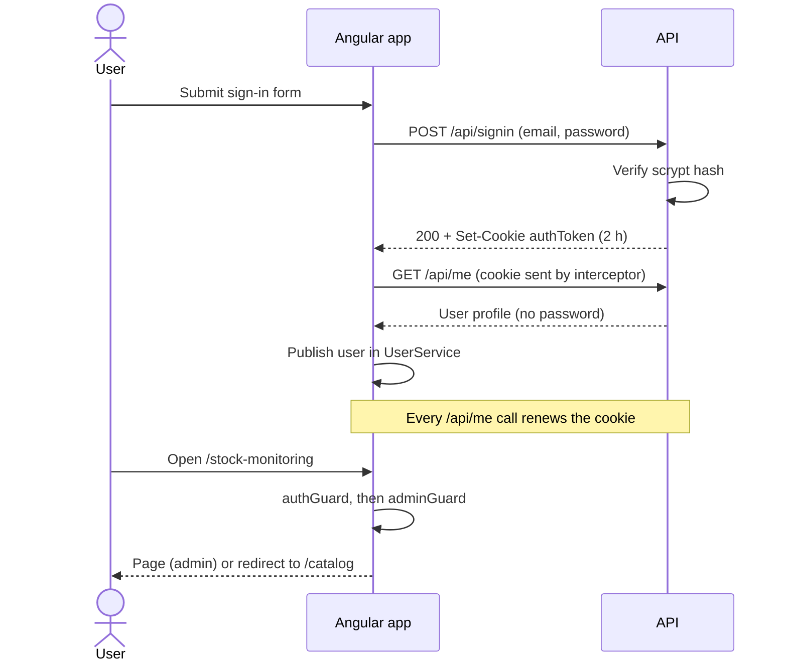

### Route access

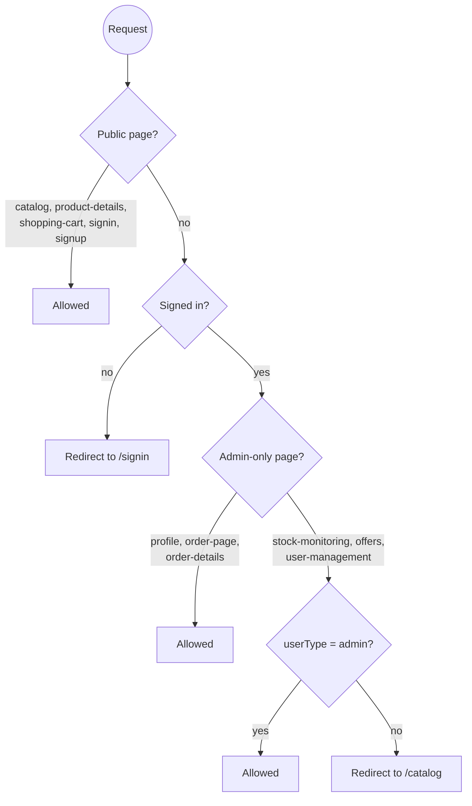

### Checkout

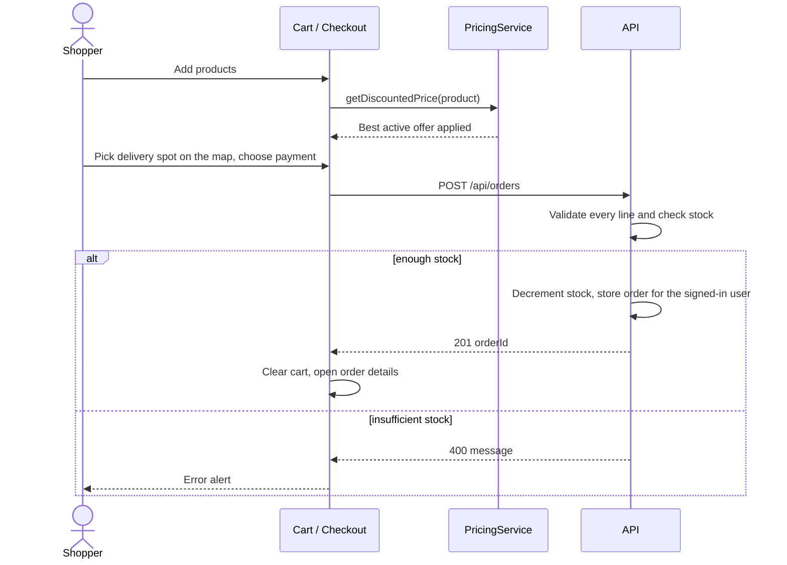

### Data model

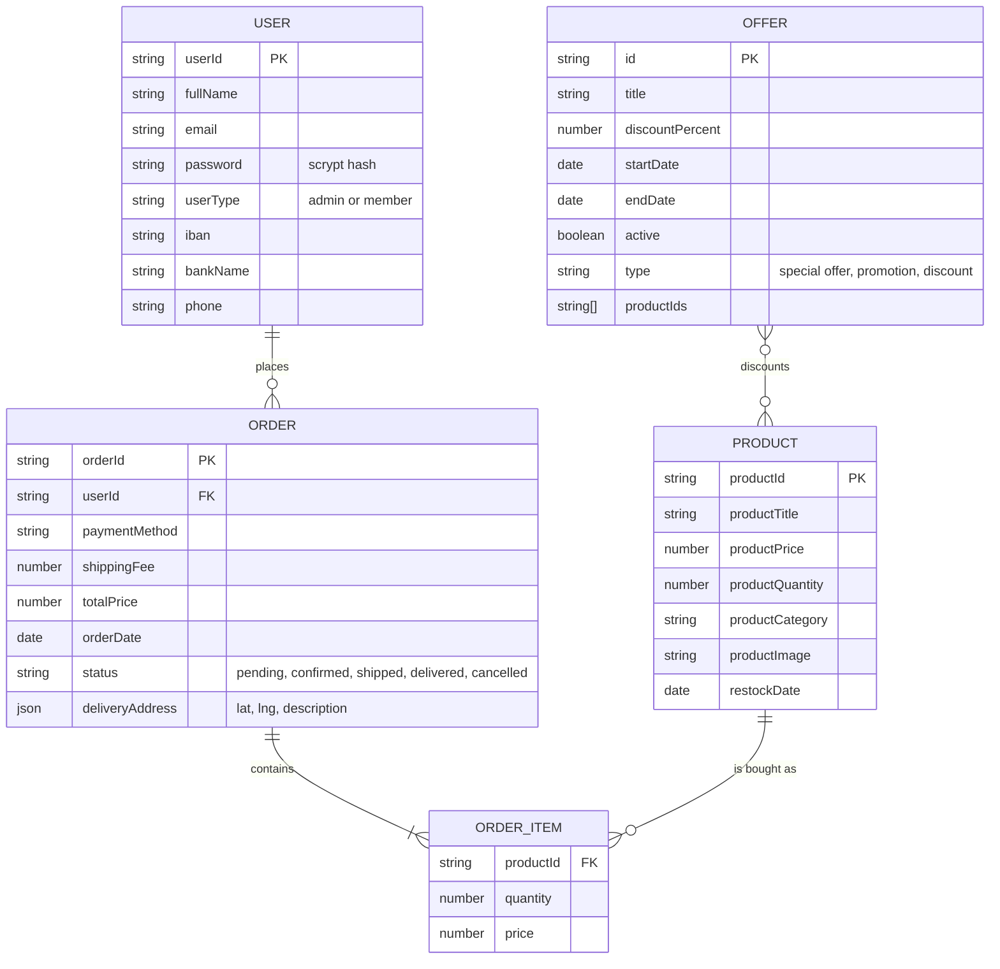

## API reference

Base URL: `http://localhost:3000/api`. "Session" means a valid auth cookie.

| Method | Endpoint | Access | Description |
| ------ | -------- | ------ | ----------- |
| GET | `/health` | public | Liveness check |
| POST | `/signup` | public | Create a member account |
| POST | `/signin` | public | Sign in, sets the auth cookie |
| POST | `/signout` | session | Clear the cookie |
| GET | `/me` | session | Current user, renews the cookie |
| GET | `/products` | public | List products |
| GET | `/products/:id` | public | One product |
| PUT | `/products/:id/stock` | admin | Add stock (`quantity > 0`) or empty it (`0`) |
| GET | `/offers`, `/offers/:id` | public | List / read offers |
| POST, PUT, DELETE | `/offers`, `/offers/:id` | admin | Manage offers |
| GET, POST | `/users` | admin | List / create users |
| PUT | `/users/:id` | owner or admin | Update profile fields |
| DELETE | `/users/:id` | admin | Delete a user |
| POST | `/orders` | session | Place an order (uses the signed-in user) |
| GET | `/orders/user/:userId` | owner or admin | Orders of a user |
| GET | `/orders/:orderId` | owner or admin | One order |

## Screenshots

| Sign in | Sign up |
| :---: | :---: |
| 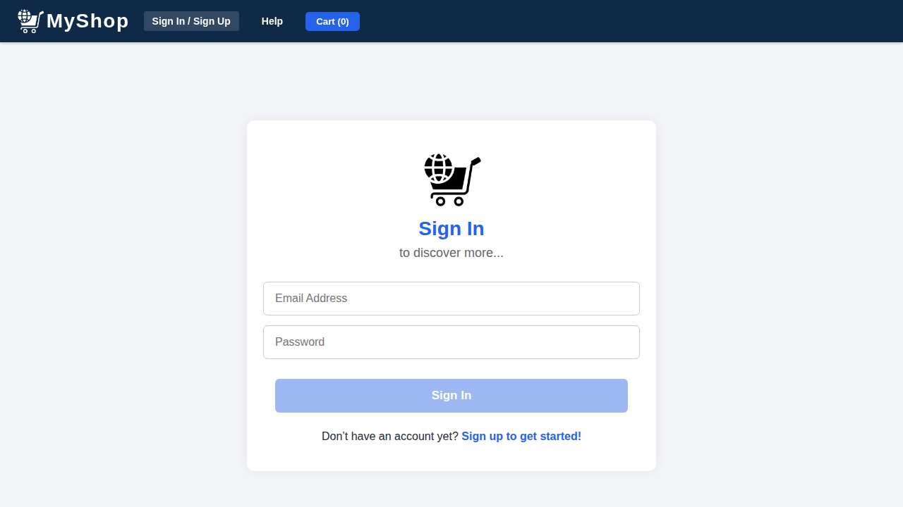 | 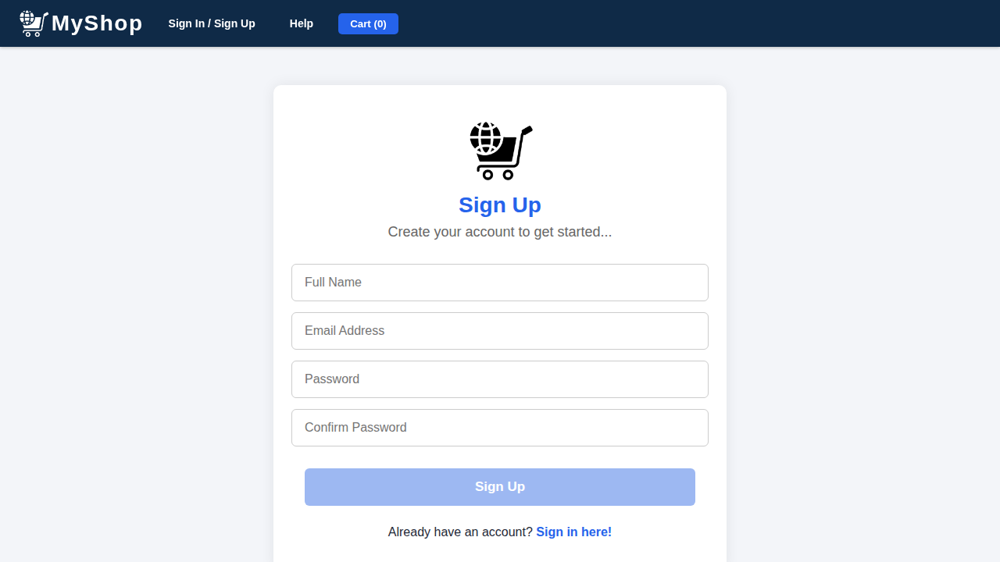 |

| Catalog | Product details |
| :---: | :---: |
|  | 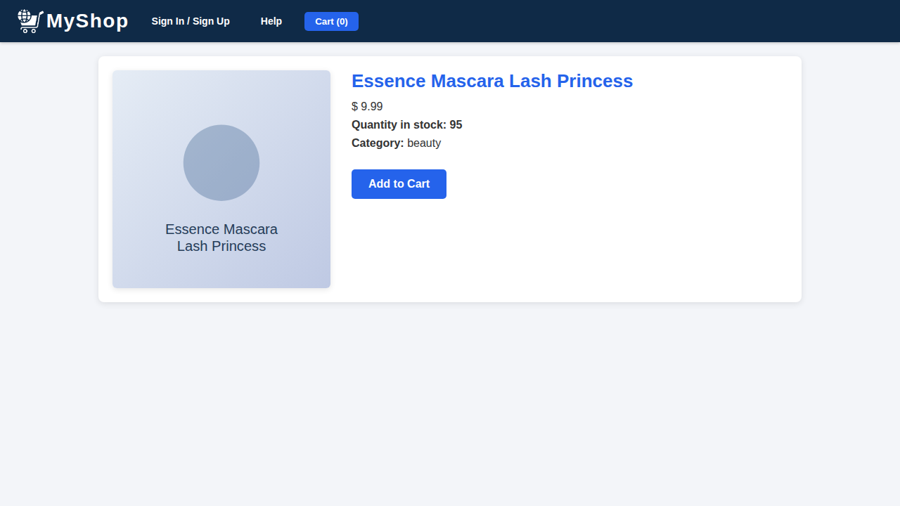 |

| Cart | Checkout |
| :---: | :---: |
| 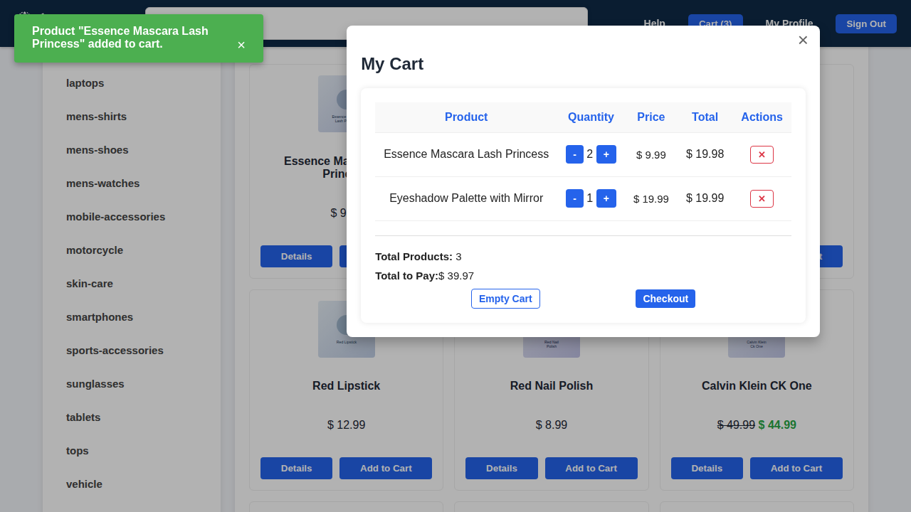 | 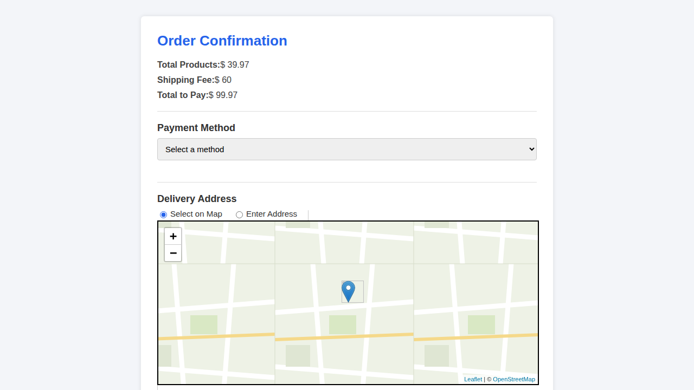 |

| Profile | Order details |
| :---: | :---: |
| 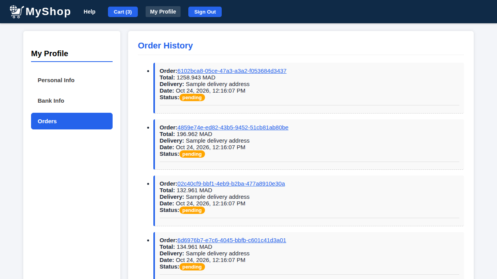 | 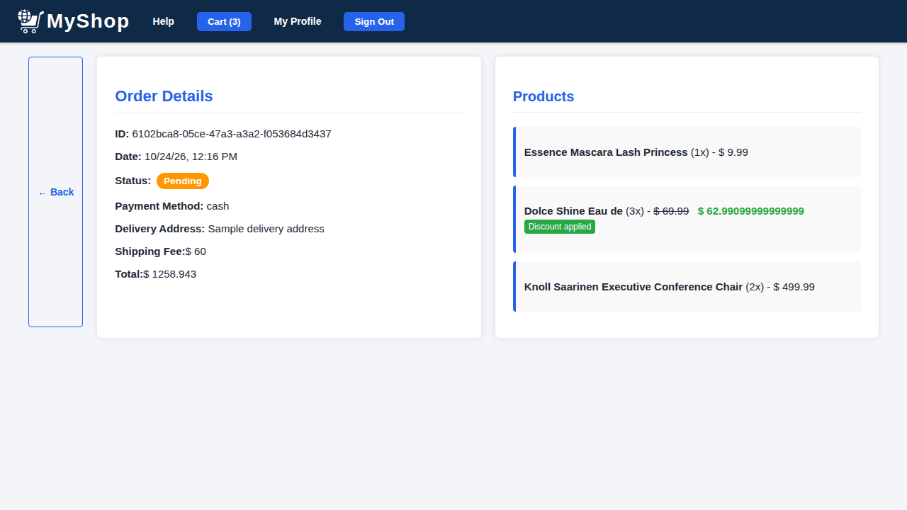 |

| Stock monitoring | Offer management |
| :---: | :---: |
| 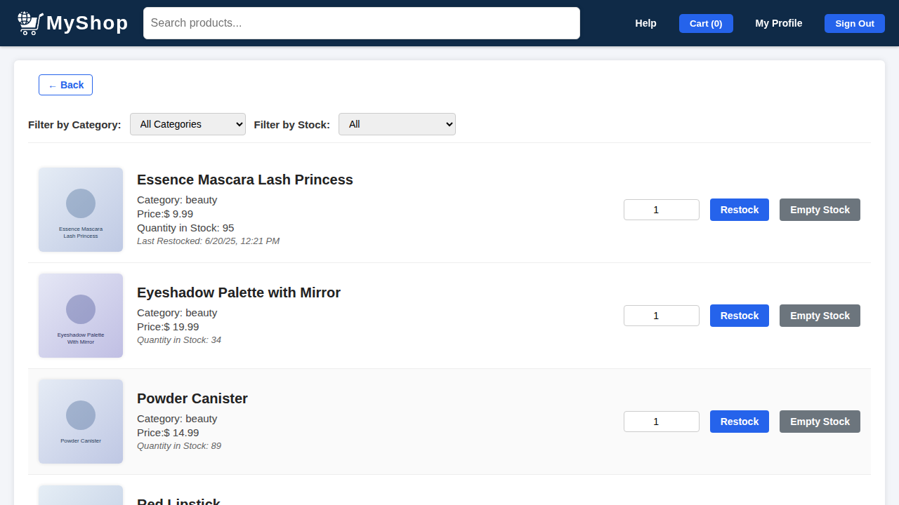 | 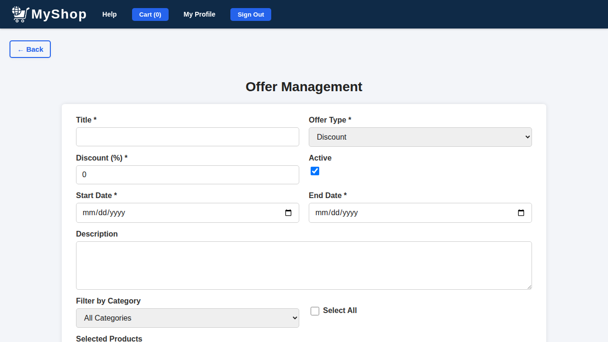 |

| User management | Arabic (RTL) |
| :---: | :---: |
| 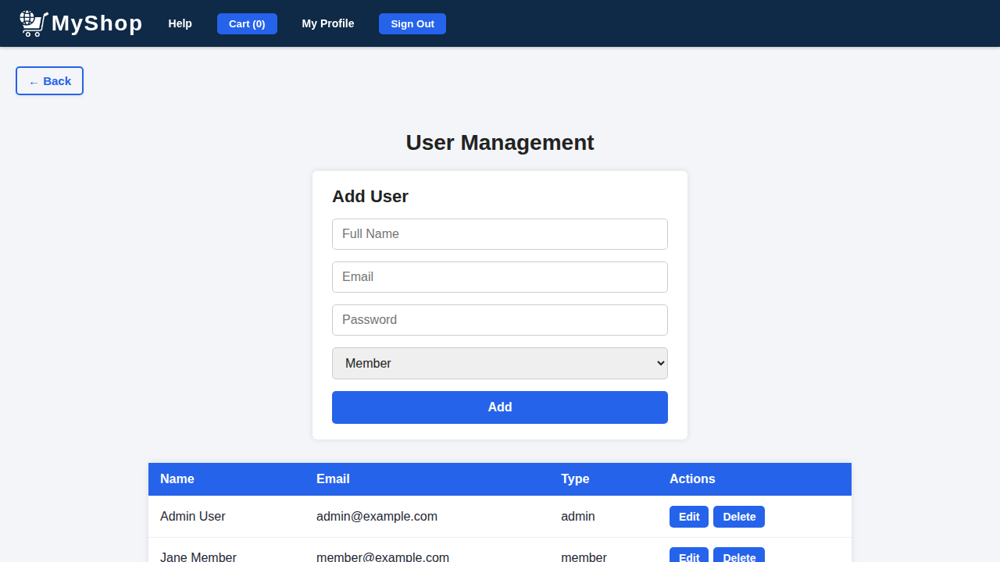 | 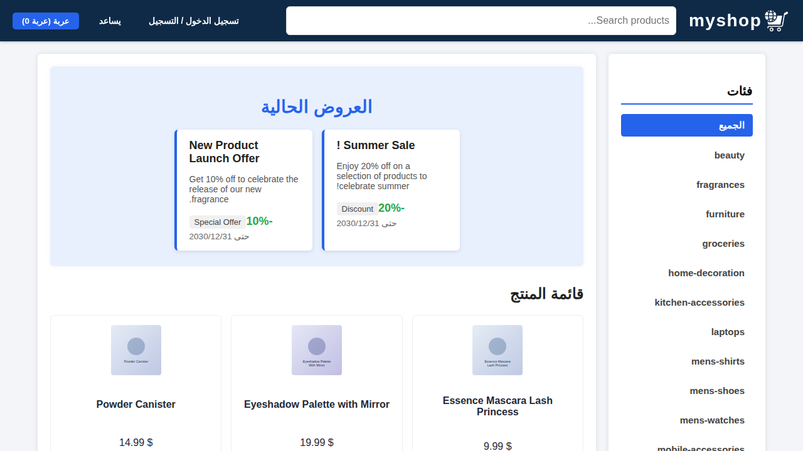 |

## Internationalization

English is the source language; `fr`, `es` and `ar` live in `src/locale`.

```bash
npm run start:fr            # dev server in French (also start:es, start:ar)
npm run build               # production build, all locales
```

After changing template text, refresh the translation catalogs:

```bash
npx ng extract-i18n --output-path src/locale
```

Then merge the new units into the `messages.<locale>.xlf` files and translate them

## Scripts

| Command | What it does |
| ------- | ------------ |
| `npm start` | Angular dev server on port 4200 |
| `npm run build` | Production build (SSR, every locale) |
| `npm test` | Unit tests (Karma + Jasmine) |
| `npm run api` | Start the REST API |
| `npm run api:install` | Install the API dependencies |
| `npm --prefix server run dev` | API with auto-reload |
| `npm --prefix server run import:products` | Rebuild `products.json` from DummyJSON |
| `npm --prefix server run hash-password -- "pw"` | Print a password hash for `users.json` |
